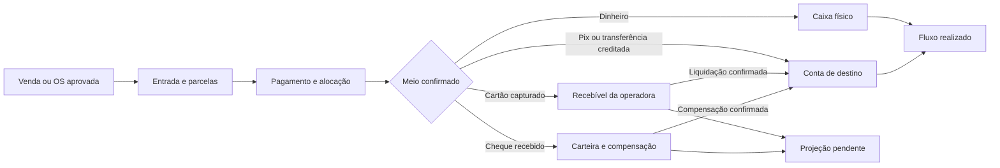

# Financeiro: pagamentos, parcelas e fluxo de caixa

Especificação revisada em 16/10/2026 para lojas de eletrônicos e manutenção de TI. Trata dos recebimentos dos clientes da loja; a mensalidade paga pela loja à plataforma pertence ao módulo de assinatura, em outro contexto.

**Estado:** requisitos e desenho de produto. A tela atual demonstra somente recebimentos manuais de OS aprovadas. Parcelas, cheques, agenda de operadoras, contas a pagar, conciliação e caixa descritos aqui ainda não foram implementados. Nenhuma integração bancária foi contratada ou homologada.

## Decisão principal

[Certeza] O modelo atual, que acumula `OS.received` e registra o método em texto no histórico, é insuficiente para estes fluxos. Não distingue dívida, instrumento recebido, liquidação, taxa e conta de destino. Selecionar “cartão” nesse formulário não implementa controle de cartão.

Adotar cinco registros relacionados, com identidades próprias:

1. **Operação comercial:** venda, OS aprovada ou outro compromisso identificado.
2. **Condição de pagamento e títulos:** entrada, parcelas, vencimentos, responsável pelo pagamento e eventuais renegociações.
3. **Pagamento/instrumento:** dinheiro, transação Pix, cartão, cheque etc., com situação e origem da confirmação.
4. **Liquidação e movimento de conta:** quanto efetivamente se tornou disponível, em qual conta e data; bruto, taxa e líquido separados.
5. **Conciliação:** correspondência entre registros internos e banco/operadora/fechamento físico, com diferenças resolvidas ou pendentes.

“Cliente pagou” e “dinheiro disponível para a loja” são informações distintas. Crédito da loja utilizado numa compra também não representa nova entrada de dinheiro. O enquadramento contábil de cada evento deve ser validado com o responsável da empresa; este módulo é um controle gerencial, sem promessa de escrituração contábil completa.

## Condição de pagamento não é meio de pagamento

À vista, entrada + parcelas, crediário/carnê e parcelamento no cartão são condições/modalidades. Dinheiro, Pix, cartão e cheque são instrumentos. Banco/caixa são destinos. Não colocar esses três conceitos em um único `select`.

Exemplo: uma venda de R$ 1.200 pode ter entrada de R$ 300 em dinheiro e saldo de R$ 900 em três parcelas de R$ 300 a cobrar pela loja. Cada parcela pode ser recebida em um meio diferente, sem criar outra venda. No cartão, as parcelas do consumidor não determinam, por si só, a agenda de liquidação contratada pela loja.

O estabelecimento ativa os meios aceitos e as condições disponíveis. “Todos os meios” significa um catálogo extensível com regras próprias; não significa habilitar integrações, financiamento ou aceitação sem contrato e validação.



Ao liquidar um recebível pendente, ele sai da previsão e entra no realizado uma única vez. Esses registros não são receitas adicionais à venda original.

## Meios e modalidades a prever

| Meio/modalidade | Dados e tratamento no sistema | Efeito no dinheiro disponível |
| --- | --- | --- |
| Dinheiro | Valor aplicado à dívida, valor entregue, troco, operador, turno e caixa físico. Emitir recibo de recebimento. | Entrada líquida efetiva no caixa; troco não é receita negativa nem novo desconto. |
| Pix imediato | Conta destinatária, valor, data, identificador e confirmação. Na fase manual, registrar quem conferiu o crédito; depois integrar o PSP. | Somente após confirmação do crédito. Print ou agendamento não é confirmação. |
| Pix Cobrança com vencimento | Título vinculado à cobrança e ao identificador; situação consultável. | Gerar QR/cobrança não produz entrada. Confirmar a liquidação uma única vez. |
| Pix Automático / débito automático | Recorrência, autorização, provedor, ocorrências e falhas por ciclo. Integração posterior. | Autorização ou agendamento não é liquidação. Cada ocorrência tem resultado próprio. |
| Transferência bancária | Banco/conta de destino, referência e crédito conferido. | Entrada na conta confirmada, respeitando o evento real; não presumir prazo único. |
| Cartão de débito / pré-pago | Credenciadora, estabelecimento, referência da transação, bruto, taxas e previsão de liquidação. | Autorização/captura não deve ser tratada como dinheiro físico nem assumir disponibilidade imediata. |
| Cartão de crédito à vista / parcelado | Modalidade, número de parcelas, credenciadora, referência, bruto, taxa e agenda contratada de liquidações. | Criar recebível da operadora. Caixa/banco só muda na liquidação; acompanhar valor líquido e diferenças. |
| Boleto | Provedor/banco, identificador, vencimento, situação, tarifas e retorno/consulta. | Emissão e comprovante enviado pelo cliente não substituem confirmação da liquidação. |
| Cheque | Emitente, referência do cheque, banco, valor, data recebida, data acordada de apresentação, custódia e depósito. Acesso restrito aos dados necessários. | Em carteira ou depositado não é saldo disponível. Registrar compensação/liberação confirmada ou devolução. |
| Carteira digital / link de pagamento | Identificar o provedor e o instrumento usado por trás do link, transação, taxas e repasse. | Link não é uma liquidação. Evitar cadastrar o mesmo pagamento uma vez como “link” e outra como cartão/Pix. |
| Vale / benefício / convênio | Aceitação apenas se aplicável e contratada; responsável pelo repasse e agenda próprios. | Recebível do convênio/provedor até liquidação confirmada. |
| Financiamento de terceiro / modalidade “pague depois” | Financiador, aprovação, contrato/referência, condições de repasse e responsabilidade pela cobrança. | Não criar carnê da loja se a obrigação passou ao financiador; caixa segue o repasse efetivo. |
| Crédito da loja / vale-troca | Saldo do cliente, origem, uso parcial e histórico. Estorno/devolução que o originou permanece rastreável. | Uso não é nova entrada; obrigação com o cliente é controlada separadamente. |
| Pagamento misto | Duas ou mais linhas com método, valor, estado e destino próprios. | Somente as linhas liquidadas alteram disponibilidade. Bloquear soma incompatível e duplicidade. |

Não coletar número completo de cartão ou CVV num formulário próprio. Projetar a integração com checkout/tokenização/terminal do provedor e confirmar seus requisitos de segurança. Uma transação aprovada não garante ausência de futura contestação.

## Fluxos que precisam funcionar

### 1. Cliente compra parcelado e volta à loja todo mês

1. Confirmar a venda/OS e registrar a condição de crediário: entrada, saldo, quantidade de parcelas e vencimentos. Não gerar parcelas sobre orçamento ainda não aceito.
2. Mostrar a prévia e exigir que a soma de entrada + parcelas corresponda ao compromisso, com descontos/acréscimos explicitados. Preservar a condição aceita.
3. A entrada só é baixada quando recebida; ela pode ter seu próprio título. Dividir o saldo em valores exatos. Exemplo sem juros: R$ 100 em 3 parcelas → R$ 33,34 + R$ 33,33 + R$ 33,33.
4. Quando o cliente voltar, localizar CPF/nome/OS/venda e selecionar a parcela. Mostrar vencimento, original, ajustes, recebido e saldo. Sugerir a mais antiga, permitindo escolha explícita com rastreabilidade.
5. Registrar o pagamento e sua alocação. Se uma parcela de R$ 300 receber R$ 200, fica parcial e mantém R$ 100 pendentes. Um pagamento pode cobrir várias parcelas com alocações explícitas.
6. Para dinheiro: exigir caixa/turno aberto, registrar valor entregue e troco. Para Pix: indicar conta e confirmação. Gerar recibo com parcelas quitadas/parciais, método, data, operador e saldo; recibo não substitui documento fiscal.
7. Se o cliente atrasar, sinalizar a parcela vencida e o valor em atraso. Não marcar toda a venda como paga por ter recebido a primeira parcela.

Não fabricar vencimentos como “30 dias para todo mês”. Dia 31 em mês curto precisa de regra explícita, ancorada no dia contratado, com prévia. Calendário, feriado, tolerância, multa, juros e descontos dependem da política e das regras contratuais/legais aplicáveis; não inserir percentuais presumidos. O protótipo inicial pode permitir editar datas e valores com conferência da soma.

### 2. Cliente usa cartão

1. Registrar pedido, transação e modalidade. Distinguir autorização, captura, cancelamento e falha/resultado desconhecido conforme o provedor. Não reenviar cegamente após timeout.
2. Na captura confirmada, indicar que o cliente pagou via cartão e acompanhar o crédito contra a operadora. Não manter o mesmo principal simultaneamente como cobrança normal do cliente e recebível da operadora.
3. Mostrar agenda de liquidação contratada, taxas previstas e líquido esperado. Não fixar “crédito em D+30” ou “débito na hora” como regras universais.
4. Quando ocorrer repasse, conciliar transações/parcelas com o valor creditado. Um lote pode agrupar muitas transações; diferenças ficam visíveis para resolução.
5. Separar taxa de venda, antecipação, aluguel/tarifa e ajustes. Configurações precisam de vigência; mudar a taxa hoje não reescreve a operação antiga.

Exemplo **hipotético**, sem recomendar taxa ou prazo: cliente paga R$ 1.000 no cartão, taxa contratada de R$ 20, líquido previsto de R$ 980. A venda continua em R$ 1.000; a taxa é registrada separadamente. Antes do repasse, o saldo disponível não cresce. No repasse confirmado, a entrada no banco é R$ 980. Não somar R$ 1.000 e R$ 980 como duas receitas ou duas entradas.

Antecipação é um evento vinculado à agenda original, com custo e valor líquido próprios. Baixar/reprogramar os direitos antecipados para impedir que apareçam novamente na previsão original. Contestação/chargeback controla valor bloqueado/debitado, evidências e resultado; não reabrir automaticamente cobrança ao cliente sem validar responsabilidade e procedimento.

### 3. Cliente entrega cheque

Estados operacionais: `em carteira → depositado → liquidado`, com ramificações para `devolvido`, `substituído`, `cancelado` ou `reapresentação autorizada` conforme situação. Depositar não pode ser um atalho para “liquidado”.

Preservar a obrigação comercial e indicar “coberto por cheque pendente”, sem duplicar o valor em aberto e o cheque na projeção. O recebimento fica condicionado até confirmação da compensação/disponibilidade, conforme a política formal adotada. Cheque devolvido mantém/restabelece a pendência correspondente sem apagar o instrumento nem registrar uma segunda venda. Substituir por dinheiro/Pix exige impedir futura baixa do mesmo cheque.

A data acordada de apresentação não é um vencimento técnico garantido pelo banco. A referência do [Banco Central sobre cheque pré-datado](https://www.bcb.gov.br/meubc/faqs/p/cheque-pre-datado) distingue o acordo e a natureza do cheque. O sistema deve preservar o acordo e alertar sobre apresentação antecipada; não prometer proteção bancária por cadastrar uma data futura.

### 4. Pagamento misto, adiantamento e recorrência

- Exemplo: R$ 200 em dinheiro + R$ 100 em Pix + R$ 700 no cartão. O resumo mostra R$ 1.000 aplicados ao compromisso, R$ 300 disponíveis após confirmação dos dois primeiros meios e R$ 700 brutos ainda com a operadora, antes das taxas.
- Receber R$ 200 em dinheiro para baixar R$ 150 gera R$ 50 de troco. Para um recebimento de R$ 500 cobrindo duas parcelas, o usuário confirma a alocação; crédito excedente nunca surge silenciosamente.
- Sinal recebido antes de definir/aprovar o compromisso pode ser um adiantamento vinculado ao cliente, com motivo e obrigação de aplicação/devolução. Não transformar uma proposta não aprovada em dívida para encaixar o sinal.
- Crediário de uma compra tem principal e fim definidos. Contrato mensal de manutenção gera cobranças por ciclo/competência, de acordo com o contrato; não repetir indefinidamente as parcelas de uma venda.

### 5. Cancelamento, estorno e renegociação

- Cancelar venda/OS não apaga dinheiro recebido. Pode gerar reembolso devido, devolução física e evento fiscal, cada qual controlado separadamente.
- Estornar registro incorreto preserva original, motivo, autor, permissão e vínculo. Devolver dinheiro ao cliente é outra operação, com conta/data e confirmação. Evitar um botão ambíguo “desfazer tudo”.
- Desconto, perdão, perda de crédito e juros não são dinheiro recebido. Registrar tipos próprios e autorização; manter original, ajustes e saldo auditáveis.
- Renegociação cria novo acordo vinculado ao anterior. Liquidado histórico permanece; parcelas substituídas deixam de compor a cobrança/projeção, evitando somar acordo antigo e novo.
- Pagamento duplicado real exige decisão de reembolso/crédito do cliente. Uma repetição técnica do mesmo evento deve ser ignorada de forma idempotente.

### 6. Crediário e cobrança de atrasados

Definir limite de crédito, condições permitidas, bloqueio por atraso e quem pode aprovar exceções, sem prometer análise automática de risco. O cadastro de CPF/CNPJ, sozinho, não comprova capacidade de pagamento. O valor ainda pendente em cheque também precisa de política explícita na exposição ao risco, evitando liberar novo crédito como se já houvesse compensação.

Mostrar histórico de acordos e contatos, faixas de atraso e responsável pela cobrança. Mensagens automáticas e consultas a serviços de crédito exigem integração, autorização e política próprias; não fazem parte da tela atual. Não adotar juros, multas ou procedimentos de cobrança apenas por serem comuns no mercado.

## Fluxo de caixa e operação de caixa são relacionados, mas distintos

**Operação de caixa:** turno da gaveta física: abertura, fundo para troco, recebimentos, despesas autorizadas, suprimento, sangria, contagem e fechamento. Pix e cartão podem aparecer no relatório do operador, sempre separados do dinheiro contado.

**Fluxo de caixa:** entradas e saídas de dinheiro disponível em todas as contas selecionadas, com histórico realizado e projeção por data. Carteira de cheques e recebíveis de operadora são direitos/pendências, sem compor o saldo disponível por padrão.

### Contas, saldos e movimentos

- Contas ativas: caixa físico, cofre, banco e conta de pagamento. Cada uma tem saldo inicial/data de corte, moeda e conciliação. Limite de cheque especial não é saldo próprio.
- Tipos: recebimento, pagamento, transferência, aporte, retirada/distribuição, tarifa, reembolso e ajuste autorizado. Categorizar para análise; não tratar todo depósito como receita de venda.
- Sangria para cofre/depósito e transferência entre contas próprias têm duas pernas vinculadas. Reduzem uma conta e aumentam outra quando efetivadas; depósitos/transferências em trânsito permanecem em trânsito. No consolidado, não são receita ou despesa operacional.
- Fechamento: calcular saldo esperado de espécie, registrar contagem cega quando adotada, diferença e aprovação. Não fabricar um ajuste automático para forçar a contagem a bater. Caixa fechado não aceita edição silenciosa; correções geram eventos autorizados.
- Contas a pagar: fornecedor de peças, parceiro, aluguel, despesas recorrentes, tributos e demais compromissos. Permitir vencimento, categoria, valor, parcelas, pagamento parcial e conta de saída. Compra a prazo não vira saída antes de pagar; repetir XML/lançamento não duplica a obrigação.

### Visões e cálculos

```text
Saldo realizado na data = saldo inicial no corte
  + entradas efetivadas desde o corte - saídas efetivadas desde o corte

Saldo projetado no horizonte = saldo realizado na data-base
  + entradas futuras ainda pendentes previstas - saídas futuras ainda pendentes previstas
```

Transferências afetam cada conta, mas seu efeito líquido consolidado entre contas incluídas é zero. Para uma conta isolada ou seleção parcial, mostrar transferências de entrada/saída explicitamente. Taxa descontada do repasse deve aparecer na decomposição do bruto/líquido e não ser subtraída de novo do saldo líquido.

Filtros: período, conta, estabelecimento, categoria, meio e responsável. Mostrar diariamente e por mês: saldo inicial, entradas, saídas, saldo final e previsto. Incluir visões 7/30/60/90 dias como atalhos, sem limitar a escolha do período.

Separar cartões/cheques pendentes, parcelas de clientes e cobrança vencida por contraparte/estado. Evitar duas previsões para o mesmo valor coberto por outro instrumento. Vencidos sem nova data confiável ficam destacados, não são movidos automaticamente para uma entrada certa “hoje”. Distinguir previsão contratada de cenário estimado. Projeção não é garantia de recebimento, lucro ou DRE.

## Conciliação e confirmações

- Começar com conferência manual identificada. Importação de extrato/arquivo da operadora e APIs entram depois, preservando a mesma regra de baixa.
- Confrontar conta, referência, valor, data e beneficiário; não conciliar apenas porque dois valores são iguais. Permitir relações um-para-muitos/muitos-para-um controladas para lotes, taxas e pagamentos agregados.
- Deduplicar por empresa, provedor/conta e identificador do evento. Webhook e conciliação manual da mesma transação apontam para o mesmo registro. Conflito de conteúdo exige revisão.
- Guardar origem da confirmação: manual com funcionário/data/evidência necessária, importada ou verificada por integração. Não chamar conferência manual de “confirmação automática do banco”.
- Pagamento online em resultado desconhecido exige consulta/reconciliação. Pagamento rejeitado não quita; agendamento não quita; recebimento parcial não quita integralmente.
- Reverter uma conciliação não é automaticamente devolver dinheiro ou apagar o lançamento bancário. Separar correção do vínculo, estorno interno e reembolso externo.

## Modelo e contratos propostos

| Entidade | Responsabilidade |
| --- | --- |
| Condição/acordo de pagamento | Origem/versão, entrada, modalidades, valores e datas aceitas. |
| Título/parcela | Direção receber/pagar, contraparte, vencimento, principal, ajustes, saldo e vínculo de substituição. |
| Pagamento/instrumento | Método, estado, provedor, referência, bruto, evidências e origem da confirmação. |
| Alocação | Valor do pagamento aplicado a cada título; saldo liquidado e cobertura pendente são conceitos distintos. |
| Agenda de liquidação | Direitos da operadora/provedor, previsões, taxas e líquido por parcela/lote; sem duplicar a obrigação do cliente. |
| Movimento de conta | Conta, valor efetivo, natureza, datas, referência e eventual reversão. Transferências têm grupo próprio. |
| Turno de caixa | Operador, abertura, fundo, movimentos, contagem, diferença e fechamento. |
| Conciliação/evento | Referências internas/externas, identidade do evento, correspondências e resolução das diferenças. |

No backend: operações transacionais, controle de versão, autorização por empresa/ação e idempotência. Não confiar em totais calculados pelo browser. Valores em decimal exato; rateios de centavos e datas precisam de política explícita. Datas de venda, competência, vencimento, recebimento, liquidação e conciliação têm significados diferentes.

Contratos candidatos: preparar/confirmar acordo de pagamento; listar títulos; registrar pagamento com alocações; consultar instrumento; confirmar liquidação; registrar reversão/reembolso; registrar despesa/pagamento; transferir valores; abrir/fechar turno; importar/conferir extrato; consultar fluxo realizado/projetado. São operações propostas, não APIs existentes.

Permissões: atendente recebe nos meios autorizados e no seu turno; financeiro concilia e acompanha vencidos; gestor autoriza desconto, renegociação, perdas, diferenças e estornos conforme limites. Técnicos não recebem acesso a todo saldo/custo por conveniência. Auditoria registra autor, instante, motivo e vínculo, com dados pessoais mínimos.

### Compatibilidade com o protótipo existente

O total acumulado em `OS.received` não contém conta, datas confiáveis, referências, taxas nem alocações das parcelas. **Não migrar esse total como entrada de caixa de hoje, Pix ou dinheiro inventado.** Preservá-lo como valor histórico informado/legado; usar data de corte e saldos iniciais confirmados para iniciar o caixa. Só reconstruir lançamentos quando existirem informações verificáveis. Novos recebimentos devem ser registros próprios, e o resumo da OS deve passar a ser derivado deles e dos ajustes legados conciliados.

Recebíveis de vendas também precisam entrar no módulo; hoje a tela considera apenas OS. Exportação, restauração, isolamento, duplicidade e saldos precisam de testes antes de usar dados reais. Estados fiscais e movimento de estoque continuam independentes.

## Telas e design funcional

| Tela/área | Conteúdo e ações de maior valor |
| --- | --- |
| Visão financeira | Disponível por conta, parcelas vencidas, a receber hoje, a pagar hoje e pendências de liquidação/conciliação. Mostrar data de atualização e escopo. |
| Contas a receber | Cliente/origem, parcela `2/4`, vencimento, original, ajustes, liquidado, coberto pendente e saldo. Filtros por atraso, vencimento e origem. |
| Receber pagamento | Selecionar títulos, alocar valores, adicionar meios, conta/turno, confirmação e prévia de troco/taxas. Mostrar o que será liquidado e o que ficará pendente antes de confirmar. |
| Cartões e repasses | Transações, agenda bruto/taxa/líquido, antecipações, divergências, estornos e contestações. |
| Cheques | Carteira, datas acordadas, custódia, depósito, confirmação, devolução e substituição; sem badge “pago” só pelo recebimento da folha. |
| Contas a pagar | Fornecedor/categoria, parcelas e vencimentos, anexos necessários, pagar parcialmente e confirmar saída. |
| Caixa do operador | Turno e conta física, fundo, recebimentos por meio, troco, sangria/suprimento, contagem e fechamento. |
| Fluxo de caixa | Realizado e projetado separados, diário/mensal, entradas/saídas, saldos e detalhamento da origem dos números. |
| Conciliação | Pendentes, sugestões explicáveis, confirmações e diferenças; ação de desfazer vínculo separada do estorno. |
| Configurações | Meios aceitos, contas, categorias, condições, políticas, credenciadoras e taxas com vigência. Segredos só no servidor. |

Saldos são apresentados em reais; títulos nunca dependem apenas de cor. Estados de título (aberto/parcial/liquidado/substituído/cancelado), atraso (derivado do vencimento/saldo), instrumento (pendente/confirmado/devolvido etc.) e conciliação permanecem separados. Usar “valor liquidado”, “a liquidar” e “disponível” com definição explícita; não reutilizar “recebido” para tudo.

Comprovantes internos identificam a loja e a origem, discriminam alocações e saldo e são reproduzíveis sem refazer a baixa. Ações destrutivas/financeiras mostram valores e efeitos concretos antes da confirmação; falhas mantêm os dados digitados e dão caminho para consulta. No celular, permitir abrir uma parcela e concluir seu recebimento sem depender de uma tabela larga para todas as ações.

## Prioridade revisada

1. **F1 — fundação demonstrável:** registros próprios de títulos/pagamentos/contas, vendas + OS, condição com entrada/parcelas, pagamento parcial/misto em dinheiro/Pix/transferência, datas e recibo. Remover a confusão entre valores legados e caixa novo.
2. **F2 — meios pendentes:** cartão e cheque com estados, agenda/compensação, taxas, liquidação manual identificada e estorno auditável. Faz parte da primeira entrega útil se esses meios são aceitos pelo piloto; não basta adicionar opções no formulário.
3. **F3 — gestão de caixa:** contas a pagar básicas, turnos, transferências, conciliação manual, realizado e projeção sem duplicidade. Esses controles são P0 para entregar o fluxo de caixa solicitado.
4. **F4 — automação:** importar extratos/arquivos e integrar PSP/credenciadoras/boleto, com confirmação autenticada e reconciliação; cobrança recorrente/antecipação integrada conforme demanda. Não prometer cobertura de qualquer banco/maquininha.
5. **F5 — gestão ampliada:** política de crédito, renegociações avançadas, contratos de manutenção, indicadores de inadimplência, custo financeiro e DRE gerencial revisada.

F1–F3 não são promessa de uma sprint. Antes de produção, precisam de backend transacional, identidade, isolamento e recuperação. A simulação do front pode anteceder essas integrações, desde que mostre claramente quais confirmações são fictícias/manuais.

## Critérios de aceite e QA

| ID | Cenário | Resultado obrigatório |
| --- | --- | --- |
| FIN-01 | R$ 1.200 com entrada de R$ 300 + 3 × R$ 300. | Soma exata; entrada só liquida quando paga; demais parcelas permanecem pendentes. |
| FIN-02 | Cliente volta e paga R$ 200 de parcela de R$ 300 em dinheiro. | R$ 100 de saldo; entrada de R$ 200 no turno; recibo vinculado; não quita as outras. |
| FIN-03 | Entrega R$ 200 para uma baixa de R$ 150. | Troco R$ 50; parcela baixa R$ 150; efeito líquido no caixa R$ 150. |
| FIN-04 | Um pagamento cobre mais de uma parcela. | Alocações explícitas; soma aplicada não supera valor/saldos; nenhum dinheiro duplicado. |
| FIN-05 | R$ 100 divididos em três e vencimento no dia 31. | Valores somam R$ 100; datas válidas e regra de mês curto explícita, sem deriva silenciosa. |
| FIN-06 | R$ 1.000 em cartão com R$ 20 de taxa hipotética. | Cliente identificado como pago via cartão; R$ 980 pendentes de repasse; disponível só cresce R$ 980 na liquidação confirmada. |
| FIN-07 | Mesmo repasse chega por webhook e importação de extrato. | Uma liquidação, um conjunto de movimentos e conciliação rastreável. |
| FIN-08 | Operadora deposita um lote com várias vendas e uma diferença. | Correspondências não duplicam as vendas; diferença não é ocultada em ajuste automático. |
| FIN-09 | Antecipar agenda de cartão. | Custo/líquido explícitos; parcelas antecipadas saem da projeção original. |
| FIN-10 | Cheque recebido/depositado ainda sem confirmação. | Visível em carteira/compensação; não compõe dinheiro disponível nem duplicação de previsão. |
| FIN-11 | Cheque devolvido e depois substituído por Pix. | Dívida mantida/restabelecida; Pix baixa uma vez; cheque substituído não liquida depois sem resolver conflito. |
| FIN-12 | Pix agendado, print ou cobrança/boleto emitido. | Não registrar liquidação só por esses eventos. |
| FIN-13 | Pagamento misto: dinheiro/Pix/cartão. | Saldos por meio e disponibilidade separados; total aplicado correto. |
| FIN-14 | Transferência entre duas contas da mesma empresa. | Duas pernas vinculadas, sem receita/despesa nova; efeito consolidado zero quando ambas estão incluídas. |
| FIN-15 | Fechamento com dinheiro contado diferente. | Registrar diferença, responsável e decisão; preservar saldo esperado e contagem originais. |
| FIN-16 | Reenviar baixa por clique duplo, job ou concorrência. | Idempotência/controle transacional impedem duplicidade e saldo negativo indevido. |
| FIN-17 | Cancelar documento fiscal/venda já paga. | Não apagar recebimento ou devolver dinheiro automaticamente. |
| FIN-18 | Renegociar três parcelas abertas. | Histórico preservado e novo acordo sem somar parcelas substituídas na dívida/projeção. |
| FIN-19 | Pagamento parcial, desconto e perda de crédito. | Cada componente separado; somente valor monetário efetivo entra no caixa. |
| FIN-20 | Migrar OS com `received` histórico e sem conta/data verificáveis. | Preservar o legado sem fabricar entrada de hoje; saldo inicial/corte definidos conscientemente. |
| FIN-21 | Duas empresas com títulos/contas de IDs semelhantes. | Acesso, arquivos, recibos e conciliação continuam isolados; permissões conferidas no servidor. |
| FIN-22 | Parcela vencida sem previsão de recuperação e conta a pagar amanhã. | Não presumir entrada certa; mostrar risco de insuficiência de saldo. |
| FIN-23 | Consumir crédito de vale-troca ou receber aporte do sócio. | Vale não vira nova entrada; aporte não vira receita de venda. |
| FIN-24 | Falha após envio de captura/reembolso ao provedor. | Consultar/reconciliar resultado desconhecido antes de repetir; não movimentar caixa por timeout. |

## Fontes e limites da pesquisa

Regras de produto, modelo de domínio, prioridades e critérios de QA acima são propostas do projeto. As fontes sustentam a distinção dos instrumentos e eventos, sem definir a taxa ou o prazo de uma contratação concreta.

- [Banco Central — instituições e arranjos de pagamento](https://www.bcb.gov.br/estabilidadefinanceira/instituicaopagamento): diferentes instrumentos e participantes; uma operação com provedor tem responsabilidades próprias.
- [Banco Central — Pix Cobrança](https://www.bcb.gov.br/meubc/faqs/p/pix-cobranca): cobranças para pagamento imediato ou com vencimento; criar a cobrança não comprova sua liquidação.
- [Banco Central — comprovantes de agendamento e aperfeiçoamentos do Pix](https://www.bcb.gov.br/detalhenoticia/20602/noticia): distinguir agendamento de transferência concluída. O sistema deve conferir o crédito.
- [Banco Central — cheque pré-datado](https://www.bcb.gov.br/meubc/faqs/p/cheque-pre-datado): data acordada de apresentação e natureza do cheque; não fixar prazos universais de compensação nesta especificação.
- [Banco Central — registro e negociação de recebíveis de cartão](https://www.bcb.gov.br/detalhenoticia/645/noticia): agenda e negociação de direitos; antecipação precisa de tratamento próprio no controle.
- [Sebrae — controle de contas a pagar e a receber](https://bibliotecas.sebrae.com.br/chronus/ARQUIVOS_CHRONUS/bds/bds.nsf/0a15c023a5a42a4f79ef5dbec278fe6a/%24File/31769.pdf): relação dos compromissos a receber e a pagar com o fluxo de caixa.

Algumas páginas do BCB usam conteúdo dinâmico: a abertura direta não expôs o texto integral, e parte da verificação se apoiou nos trechos oficiais indexados. Não houve validação de contrato bancário, teste de API, comparação de taxas, auditoria contábil ou parecer jurídico. Prazos, encargos, elegibilidade e meios aceitos precisam ser confirmados na implantação.
