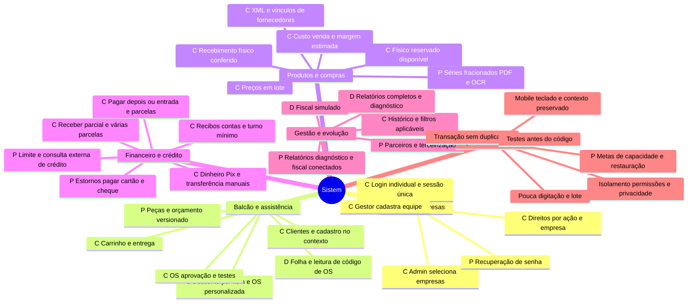

# Mapa mental do Sistem

Publicação desta revisão conferida em29/10: [evidências e limites](15-auditoria-acessos-e-filtros.md). Registros locais de execução anteriores mantêm seu contexto histórico.

Referência: **29/10/2026**. Versão visual: [abrir mapa em SVG](evidencias/mapa-mental-sistem.svg), independente de serviço externo e ampliável para apresentação. As listas abaixo também permitem ler o mapa sem renderizador Mermaid ou cores.

**C = conectado no recorte atual · D = somente demonstração · P = pendente.** C não significa módulo completo nem produção homologada. [Regras](16-regras-de-negocio.md), [requisitos](17-requisitos-funcionais-e-nao-funcionais.md) e [resumo para o cliente](19-resumo-para-clientes.md).

## Leitura por ramo

| Ramo | Objetivo para a loja | Entregue no recorte conectado | Evoluções |
| --- | --- | --- | --- |
| Acesso e empresas | Liberar somente pessoas selecionadas. | Login individual, cadastro central de empresas, gestores e direitos por ação. | Recuperação de senha/convites; capacidade de novos bancos preparada administrativamente. |
| Balcão e assistência | Atender sem abandonar o que já foi preenchido. | Cadastros no contexto, venda com vários produtos, entrega, OS, aprovação e testes. Desconto por item, seletores unificados, recebimento de parcelas da OS no contexto e comprovante básico personalizado publicados em29/10. | Leitor de OS conectado, orçamento versionado, peças e custódia ampliada. |
| Produtos e compras | Reconhecer mercadoria e manter saldo correto. | Preços e estimativas, XML assistido, vínculos de fornecedor, recebimentos e reservas. | Séries individuais, fracionamento, PDF/OCR e IA opcional. |
| Financeiro e crédito | Saber o combinado, o recebido e o pendente. | Entrada/parcelas, recebimentos parciais, recibos, contas e caixa mínimo. | Limite/exposição, consulta externa, estornos, pagar e demais meios. |
| Gestão e evolução | Entender alterações e acompanhar resultados. | Autoria/horário, histórico e filtros conforme módulo. | Relatórios completos, diagnóstico central por empresa, fiscal e parceiros reais. |
| Qualidade transversal | Confiar nos dados com menos trabalho diário. | Base de autorização, transações e proteção contra repetição nos comandos cobertos. | Validação ampla de acessibilidade, carga, metas de serviço e restauração. |

O mapa resume estados; as restrições de séries, conferência financeira da entrega da OS, XML e meios de pagamento permanecem detalhadas nos requisitos. Demonstração não é evidência de integração real.
